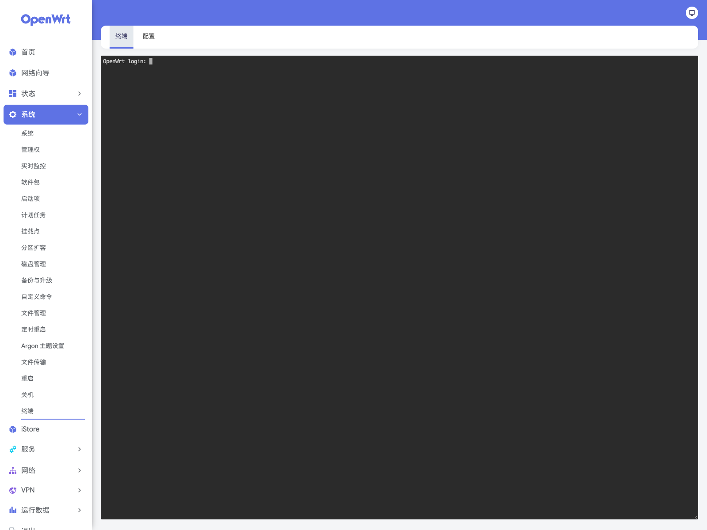
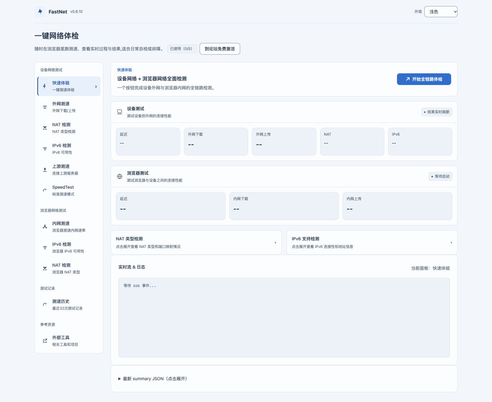
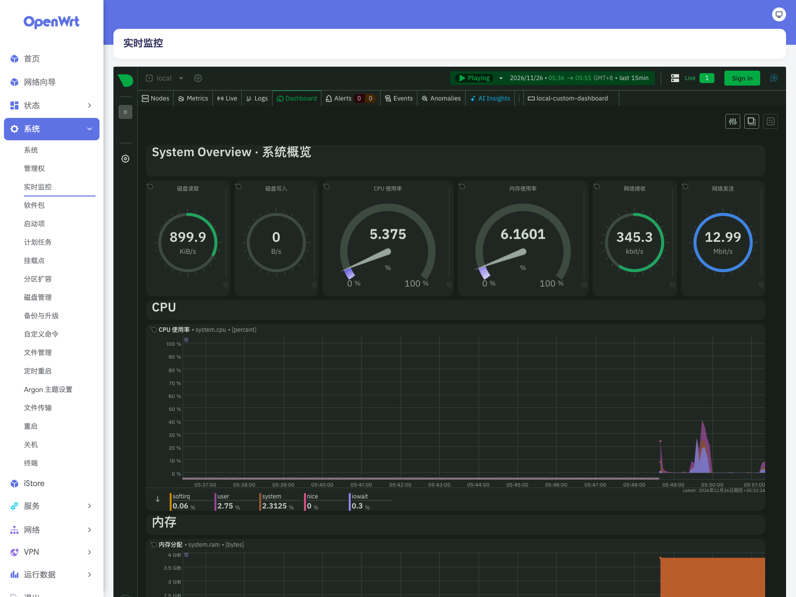

# 25.12.6-20261126 完整镜像验收

固件源码 `884bd6a78c4c8ae00cacf83d7b388f803172330b`，由 [GitHub 完整构建 45694048554](https://github.com/jearton/prowrt/actions/runs/45694048554) 生成。共 483 包，逐包版本、内核模块 ABI、根文件系统权限、gzip 和只读身份记录校验通过。

镜像 SHA256：`e0a651cb3eceaec223c2c6169fb286c3b264880a0fedcb2641cb4584dbd48728`。发布使用原始四个附件，没有重新打包，也没有从装过候选 APK 的旧 VM 导出磁盘。

## 同镜像 CI

- 首次完整构建的启动验收已完成空密码限制、首次终端系统认证和命令执行，但在立即新建终端连接时发生一次 WebSocket 握手断开，该 run 标红且没有发布候选。
- [独立复验 45707970121](https://github.com/jearton/prowrt/actions/runs/45707970121) 使用完全相同的镜像、源码和验收程序，全部通过；没有跳过断言、放宽权限或覆盖软件包。
- 通过 IPv6 禁用、原生 DNS UDP／TCP、默认上游、LuCI HTTP／HTTPS、终端登录与拒绝未授权连接、LAN 强制 DNS、OpenClash 大 YAML 保存／应用及 DNS 联动检查。
- 首次握手中断的原因未定位，不宣称已修复。Mac 的真实登录、命令执行及重新加载后再次要求登录也通过，不能把一次 CI 中断写成物理机终端故障已修复。

[CI 原始验收身份](evidence/firmware-20261126/acceptance.json)

## PVE 全新安装与 Mac 浏览器

- 从 CI 原始附件校验后解压、导入新磁盘；保留原盘，使用全新可写空间，没有安装 APK 覆盖包。
- 镜像内 `/rom/usr/share/prowrt/build.json` 与 CI 附件逐字段一致；版本为 `25.12.6-20261126`，源码干净。
- IPv6 内核参数继续禁用，没有 IPv6 接口地址。Netdata、ttyd、Technitium、FastNet 默认运行。
- Technitium 本地域名 UDP／TCP 查询通过；新装 SNMP 默认关闭，FastNet 没有自动添加 WAN 3200 放行。
- Mac Chrome 匿名上下文显示正常登录表单；HTTP／HTTPS 均可建立原生 LuCI 登录态并打开官方 FastNet 入口。
- 首页家长控制卡片移除；测速无安装弹窗；浮动网关页签隐藏；全局 IP 限速和限速设备列表均进入已安装的原生 EQoS。
- 终端先显示系统登录提示，输入账号密码后执行实际命令；重新加载后再次要求登录。1600×1200 窗口下输入区域高约 1050 CSS px。
- 实时监控默认显示 System Overview，本机图表正常，原生 API 报告无云账号认证。阻断外部页面资源请求后，FastNet 和本地监控仍能渲染。
- Technitium LuCI 页面正常，浏览器未捕获脚本异常。本轮没有修改 Technitium 或 Console 源码。

[新盘安装结果](evidence/firmware-20261126/installed-result.json)、[Mac Chrome 结果](evidence/firmware-20261126/browser-full-result.json)

## SNMP 与升级保留

- 使用独立缓存样例验证设备行、首页数量和只读提示；认证摘要正常，未认证 401，写请求 403。
- 新服务检测到启用的旧采集器时直接复用，没有第二个采集轮询进程。
- 原生 `sysupgrade -l` 包含配置、私有凭据目录、旧服务和名称采集脚本。
- 模拟旧系统缺少新 keep.d 清单：`--check` 正确报缺项，`--prepare` 实际生成备份并确认包含上述文件，测试后恢复保留清单。
- 备份及浏览器 Cookie、测试密码未上传仓库或 Release。Net-SNMP 包版本为 `5.9.4-r6`，该构建的程序版本字符串为 `5.9.4.pre2`，分别记录。

[权限及合并结果](evidence/firmware-20261126/home-result.json)、[旧采集器复用](evidence/firmware-20261126/preservation-result.json)、[首次升级备份](evidence/firmware-20261126/snmp-upgrade-result.json)

## 范围与环境恢复

- 实验 LAN 不连接物理生产接口；虚拟 WAN 使用 QEMU 用户态 NAT，没有修改生产网络、交换机或路由器。
- 测试结束恢复 VM 原磁盘、原网卡和电源状态；9000 运行、9001 关闭，清理本轮地址、路由、邻居及 HTTP 隧道。独立候选盘保留供追溯。
- 本轮只验证 FastNet 安装、服务和页面兼容，没有执行外网带宽测速或绕过激活；原生页面保留五次体验／论坛激活提示。
- 物理网口映射、传感器及硬件驱动由目标物理机验证。
- 用户确认同源流量速率／排序和逐 IP 默认固定限速留待下一版。当前版本不会迁移这些现场包文件补丁；升级边界和回滚见 [FastNet 维护说明](quickstart-fastnet-20261126.md)。
