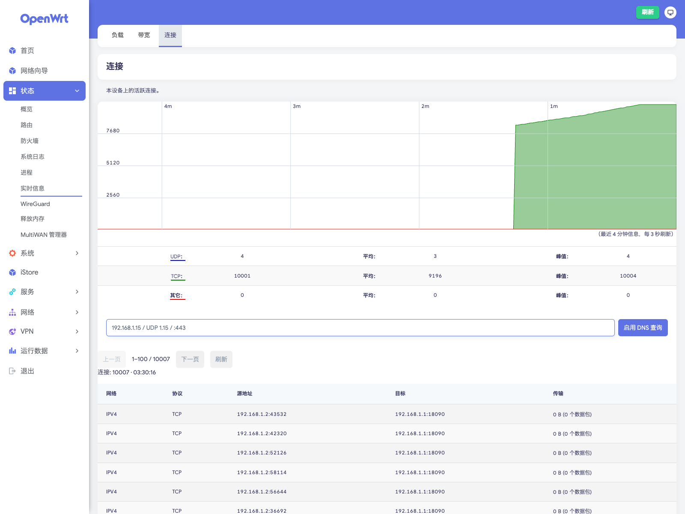
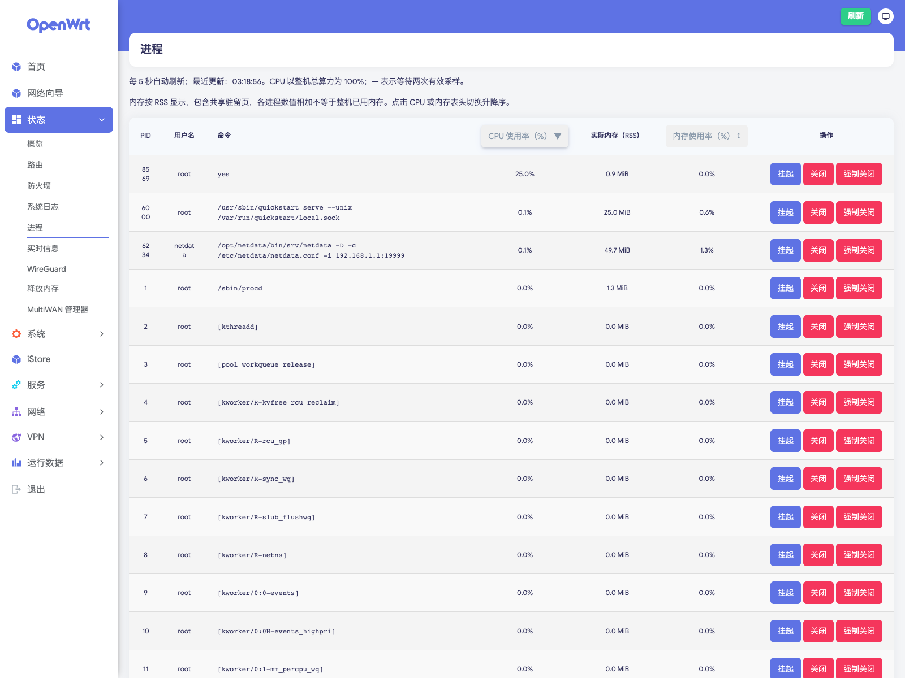

# 25.12.6-20261126.1 完整镜像验收

本版源码为 `85a30565889bce41518be49b58c25e1d15645b24`，由 [完整 CI 45874343349](https://github.com/jearton/prowrt/actions/runs/45874343349) 构建。483 包精确版本、内核 ABI、根目录权限和固件身份检查通过。CI 总耗时 61 分 27 秒。

发布使用原始镜像、包清单、`build.json` 和 `SHA256SUMS`，没有重新打包、修改镜像或安装 APK 覆盖。镜像 SHA256：`12baa1b59c35a1f9848191de9acf8b99c2d5d0de068a1b62181d7e71b40aa9cd`。

## 新磁盘与 Mac 浏览器

- 将原始镜像导入新磁盘；`/rom` 身份与 CI 附件一致，默认服务、IPv6 禁用及 UDP／TCP 本地 DNS 检查通过。
- 真实 Mac Chrome 验证正常登录、终端系统认证、重新加载后再次登录和自适应高度。
- 本地 Netdata 原生概览、无需云账号、FastNet 官方入口、隐藏浮动网关、原生 EQoS 入口及 Technitium 页面检查通过。
- SNMP 默认关闭，FastNet 不自动开放 WAN 3200；没有改变此前 DNS／代理默认策略。

## 本轮 Web 修复与进程页

- 新镜像实际内置的 uhttpd 模块通过允许／拒绝、三种接口权限不回复、超时、批量后续项、订阅、迟到回复及连接清理检查。等待权限时静态请求仍能完成。
- `luci-base` 与 `luci-mod-status` 为 r2，连接页使用原生认证 HTTP 全快照读取。
- 5000／10000 条真实 TCP 连接分别解析 5014／10007 条记录，包含管理连接；每页只渲染 100 行，全表过滤找齐测试连接、下一页与数值排序通过。
- 两次 rpcd 和登录会话均稳定；最长浏览器主线程任务分别为 54／70 ms。
- 旧 RPC 超限返回非认证状态 8，匿名文件读取 403；读取失败可见并能恢复，重复刷新不叠加列表请求。
- RSS 比例、实际 CPU 增量、一位小数、5 秒刷新、CPU／内存双向数值排序和刷新保持选择通过。
- 进程接口拒绝匿名、注销及未授权会话；授权读取 200、POST 405，只读会话的信号按钮禁用。HTTP／HTTPS 使用本协议会话通过。
- 进程页和连接页同时存在，原生权限没有放宽，没有新增常驻采集服务。

第一次安装已完成默认服务、uhttpd、基础页面和 RSS 页面检查，但临时权限测试夹具误向 `nixio.fs.chmod` 传入数值模式，夹具中断。实机临时文件探测确认 API 要求模式字符串；改为测试脚本 `umask 077` 后，使用同一原始 CI 镜像的新盘补完权限及大连接检查。没有改动固件或放宽断言，未重复已完成的页面和 ACL 场景。初次中断和后续结果分别保留，不能将其写为首次完整流程无中断。

[组合验收数据](evidence/firmware-20261126.1/acceptance.json)、[基础页面](evidence/firmware-20261126.1/browser-full.json)、[进程页](evidence/firmware-20261126.1/processes.json)、[只读权限](evidence/firmware-20261126.1/process-permissions.json)

## 发布与匿名校验

- [GitHub 正式版](https://github.com/jearton/prowrt/releases/tag/v25.12.6-20261126.1) 的四附件在草稿阶段逐项核对大小、SHA256 和说明后发布，tag 指向实际构建源码。
- GitHub 公开资产 API 不带认证头完整下载四附件，SHA256、gzip 及身份一致。当前 Mac 网络首次直链下载遇到 TLS 超时，因此记录实际成功的公共资产 API 路径。
- [GHCR 发布 45884609070](https://github.com/jearton/prowrt/actions/runs/45884609070) 通过；以空 registry 配置、无缓存按 OCI 摘要完整匿名拉取，再核对校验和及镜像内身份。
- 不可变引用：`ghcr.io/jearton/prowrt@sha256:e87cf42a65480a59d15e22f4dc930f4f8d85a41ee2024046018993c3f5a410a9`。

[发布证据](evidence/firmware-20261126.1/publication.json)、[GitHub 匿名下载](evidence/firmware-20261126.1/anonymous-release.json)、[GHCR 匿名拉取](evidence/firmware-20261126.1/publisher.json)

## 环境恢复与边界

实验 LAN 保持隔离，IPv6 保持禁用；仅使用虚拟 WAN 用户态 NAT。测试进程、临时会话和通道清理，原实验磁盘、网卡及电源状态恢复，9000 运行、9001 停止。[独立读回](evidence/firmware-20261126.1/restored.json)

本轮没有在生产物理机刷入此完整镜像。物理网口、传感器及硬件驱动仍由目标机器验证。现场同源流量速率与逐 IP 默认固定限速留待下一版，保留 UCI 不会保留被软件包覆盖的独立文件；按模块迁移，不能整份恢复旧菜单、RPC 或 `/www` 覆盖本版修复。
