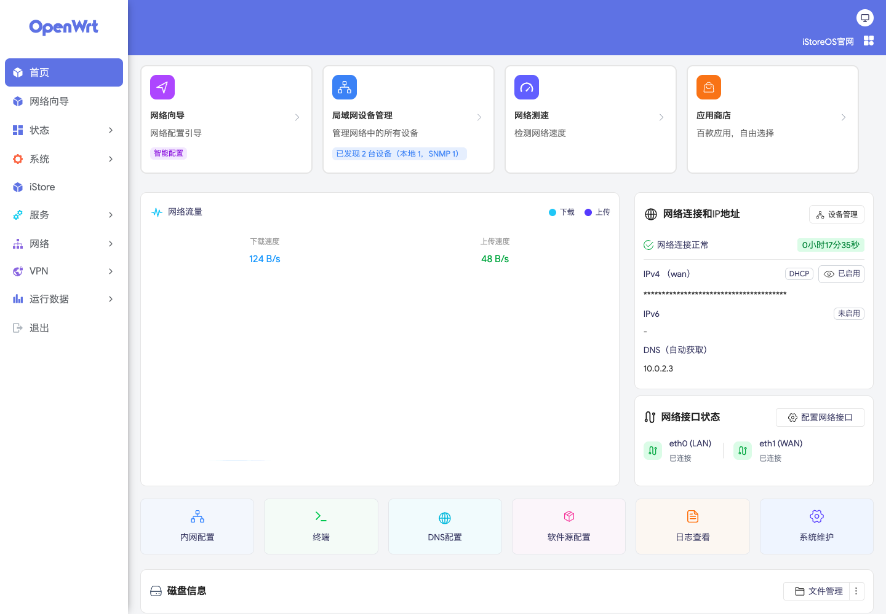
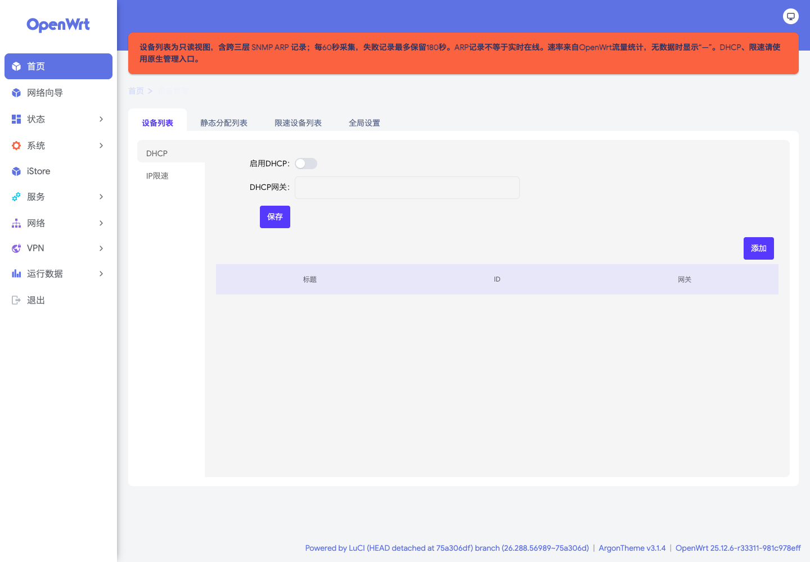
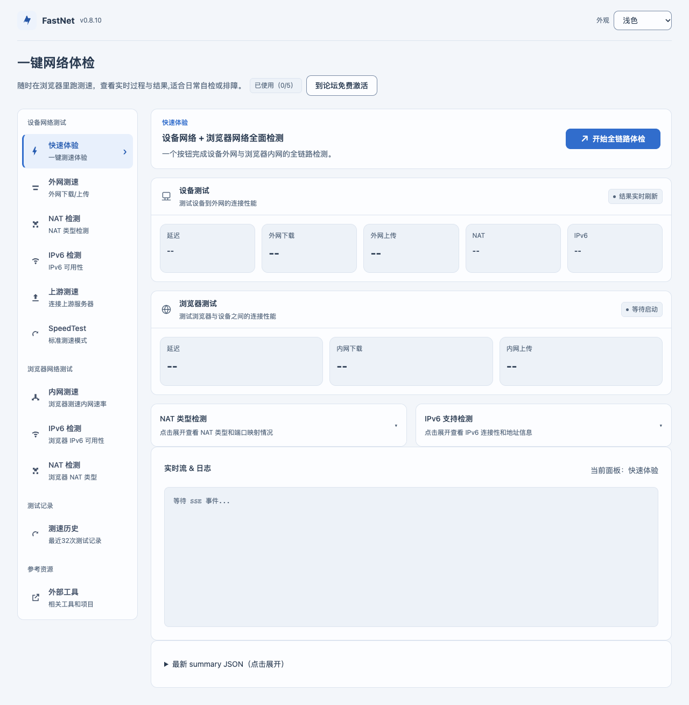

# FastNet 与首页入口集成（2026-11-26）

本轮已通过 **x86_64 APK 安装、运行服务、Mac Chrome 页面与入口兼容验收**，接入下一构建的源码。测试是在 `25.12.6-20261124.3` 新磁盘上安装候选 APK；这不等于新的完整固件已经构建、发布或经过整包重装。历史 `.3` 发布附件保持不变。

## 修改清单

1. **内置 FastNet 0.8.10**：采用 iStoreOS 官方应用仓库的 APK 配方与发布的 x86_64 二进制，包含共享认证、应用注册组件和中文包，不引入 Docker 或整个 LinkEaseFull。锁定来源见 [fastnet.lock.json](../fastnet.lock.json)。本项目没有修改 FastNet 可执行程序；公开 app hub 包含集成代码和配方，不能据此宣称运行时程序全部开源。
2. **取消自动开放 WAN**：FastNet 本地 `r4` 配方删除官方 `uci-defaults` 中创建 `firewall.fastnet`、放行 WAN TCP 3200 的部分；不删除管理员已有同名规则。服务仍使用官方默认端口 3200，可在 LuCI 修改，是否可达由部署者防火墙决定。
3. **修复首页测速入口**：直接进入已内置的 `/cgi-bin/luci/admin/services/fastnet`，不再先检查或安装 `app-meta-fastnet`。LuCI 的“打开 Web 界面”沿用官方共享认证入口，实际打开原生 FastNet Web UI。
4. **删除家长控制卡片**：只从 QuickStart 快捷卡片中移除；OAF 原生服务、规则和软件包不受此项调整影响。
5. **隐藏浮动网关入口**：移除设备管理“全局设置”中的浮动网关页签，不安装 `floatip`。
6. **限速接现有 EQoS**：IP 限速页签、限速设备列表及其快捷配置操作跳转 `/cgi-bin/luci/admin/network/eqos`；移除初始化阶段的旧 `app-meta-eqos`、`app-meta-floatip` 安装状态查询。不会自动开启 EQoS 或改带宽参数。
7. **保留 SNMP 发现**：QuickStart 成功响应补齐 `success=0` 后合并已有 SNMP 缓存；保留设备来源、首页发现数量、缓存名称和只读保护。未登录的摘要查询返回 401，SNMP 模式的 QuickStart `/lanctrl/` 写请求返回 403。不修改 QuickStart Go 后台，不把交换机端口吞吐当作终端流量，不向内核 ARP 写入伪造邻居。
8. **提供可选通用采集器**：`prowrt-snmp-discovery` 使用 Net-SNMP TLS 构建的客户端进行只读 SNMPv3 查询；协议是否加密仍取决于配置的 SNMPv3 安全级别。默认关闭，没有交换机地址、业务网段或凭据。保留现场既有配置路径以兼容迁移。
9. **保留既有测速工具**：`luci-app-netspeedtest`、iperf3 和 LibreSpeed 不移除。FastNet 0.8.10 页面显示“已使用（0/5）／到论坛免费激活”，本项目不绕过激活、不承诺无限免费设备测速。

## 包版本与构建入口

| 包 | 候选版本 |
| --- | --- |
| fastnet | 0.8.10-r4 |
| luci-app-fastnet | 0.8.10-r1 |
| luci-i18n-fastnet-zh-cn | 0 |
| app-meta-fastnet | 0.8.10-r23 |
| linkease-app-entry | 3.0.24-r1 |
| luci-lib-linkeaseauth | 1.2.1-r5 |
| luci-app-quickstart | 0.12.10-r3 |
| prowrt-snmp-discovery | 1.0.0-r1 |
| snmp-utils-ssl / libnetsnmp-ssl | 5.9.4-r6 |
| libpci | 3.14.0-r2 |

FastNet 配方位于 `sources/full/package/custom/{fastnet,luci-app-fastnet,app-meta-fastnet,linkease-app-entry,luci-lib-linkeaseauth}`。共享的 APK metadata 框架固定在 `sources/full/package/fastnet-meta.mk`，未修改其内容；metadata 配方只调整相对引用并提升 release。

`prepare-quickstart-devices.py` 校验上游三个文件的 SHA256，再执行精确替换；来源变化会停止构建，不能静默套用旧补丁。静态资源 URL 随修改生成新指纹，避免浏览器继续用旧首页。`build-full.sh`、构建 profile 和预期包清单同步包含上述新依赖，仍校验 IPv6 禁用。

## SNMP 与旧配置兼容

- 列表合并开关仍为 `quickstart.main.snmp_discovery=1`；读取 `/tmp/lingjing-snmp/clients.json`，本机邻居优先，最多合并 4096 条、180 秒内的观察记录。ARP 观察不是实时在线证明。
- 已有 `lingjing-snmp` 服务若处于启用状态，新服务直接复用，不增加第二个轮询器。原服务附带的 DHCP／PTR 名称采集流程不被新包替换。
- 通用采集器配置是 `/etc/config/lingjing_snmp`；需要部署者添加启用的 `source`、交换机 `host` 和允许的 `networks`，并在 `/etc/lingjing-snmp/<source>/snmp.conf` 配置 SNMPv3 凭据。目录权限 700、凭据文件 600。程序读取原路径，不将凭据放在 UCI 或命令参数中。
- 新装系统的 `lingjing_snmp.main.enabled=0`，不扫描网络。配置妥当后才启用 `prowrt-snmp-discovery`；循环每轮结束后等待 60 秒。`logread -e prowrt-snmp` 查看复用状态，`logread -e lingjing-snmp` 查看采集失败。
- 名称层只消费已有 `/tmp/lingjing-dhcp-names/names.json`。没有把现场固定 Technitium 作用域／反向区的采集脚本改造成通用默认值。
- `lib/upgrade/keep.d/prowrt-snmp` 保留原配置、私有凭据目录、旧服务、旧 SNMP／名称采集器及其启动链接。保留升级配置时生效；无配置升级或全新安装不会凭空带回现场凭据。
- QuickStart 的 `device_interfaces` 多接口选择继续有效；首页数量也使用这些已配置接口。SNMP 启用后设备列表只读，管理使用原生页面。

## 隔离验收

- Linux 构建器生成 APK；虚拟机以 `--no-network --repositories-file /dev/null` 安装完整依赖集成功，不依赖设备在线拉包。
- 原始 FastNet 包安装后服务启动成功；定制 `r4` 安装前后的防火墙导出完全相同。新包不再自动添加 WAN 3200 放行。
- Mac Chrome 分别通过 HTTP、HTTPS LuCI 设置页及官方打开按钮进入 FastNet 0.8.10；无页面脚本异常。HTTPS 设置页跳转原生独立 HTTP Web UI，是官方启动方式，不是向 HTTPS iframe 嵌入 HTTP。
- 浏览器阻断外部资源请求后界面仍可渲染；这证明页面资源随包提供，不等于免费激活或外网测速无需联网。
- 首页无家长控制卡片，测速点击无安装弹窗；浮动网关页签不可见。全局 IP 限速及限速设备列表均打开已安装的 EQoS 页面，没有“软件暂未安装”。
- 使用隔离 SNMP 缓存 fixture 验证设备行、首页本地／SNMP 数量和只读提示；认证摘要 200、未认证 401、写请求 403。Lua 检查覆盖原生成功省略字段、重复抑制、本地优先、过期记录／缓存和名称匹配。
- 重新安装候选 SNMP 包时，修改过的配置保留，新默认值写为 `.apk-new`。同时验证旧采集器复用、不重复轮询，`sysupgrade -l` 包含旧配置、凭据和采集脚本。
- 独立构建配置树 `make defconfig` 通过；所有新增包、EQoS、原 netspeedtest 均保持 `=y`，IPv6 启动参数保持禁用。
- 实验 LAN 桥未连接物理生产接口；虚拟 WAN 沿用 QEMU 用户态 NAT。本轮没有启动外网带宽测速，没有修改物理机、交换机或生产 DHCP／DNS。

证据：[包 SHA256](evidence/fastnet-20261126/apk-sha256.json)、[Chrome 启动结果](evidence/fastnet-20261126/browser-result.json)、[首页与权限结果](evidence/fastnet-20261126/home-result.json)、[构建配置](evidence/fastnet-20261126/config-result.json)、[配置保留](evidence/fastnet-20261126/preservation-result.json)。完整候选镜像尚未构建，这些结果不能当作整包安装验收。







## 回滚

本轮在独立候选源码分支维护；原正式发布、原虚拟机磁盘和原配置不覆盖。包级回滚前备份 QuickStart 配置、SNMP 配置／凭据目录和已安装 APK 清单；恢复匹配旧版的 `luci-app-quickstart` 及其现场 SNMP 钩子，不能仅装回原 r2 就宣称仍有 SNMP。停用新采集服务后再移除新包；被其他应用复用的共享认证／注册和 SNMP 库不强行删除。测试环境结束恢复原磁盘与电源状态，保留候选盘供追溯。

## 首次从未集成 SNMP 的旧固件升级

**新镜像里的 keep.d 清单只负责安装后的后续升级，不能改变旧系统在刷写前生成的备份。** 因此，第一次从 `.3` 加现场脚本的系统升级，需要先在旧系统执行 [升级前预检脚本](../scripts/prepare-snmp-upgrade.sh)：

```sh
sh /tmp/prepare-snmp-upgrade.sh --check
# 核对预检报告后，准备保留清单及私有备份；这一步不会刷机。
sh /tmp/prepare-snmp-upgrade.sh --prepare
```

脚本将现存的 SNMP 配置／私有目录、旧采集服务及 DHCP 名称采集器补入 `/etc/sysupgrade.conf`，回读原生保留列表，并实际生成、检查备份归档。失败时恢复原 sysupgrade.conf。须把生成的私有 `.tar.gz` **下载到电脑**，再执行保留配置升级；`/tmp` 本身不会跨升级保留。备份包含凭据，不能上传公开仓库或 Release。

不要整份恢复旧 LuCI 控制器、QuickStart 主 JS 或 `/www`，否则会覆盖新入口与 SNMP 钩子。全新安装、不保留配置或更换磁盘时，应由管理员另行迁移这份私有配置和采集器；新固件不会自动恢复旧磁盘中的信息。
